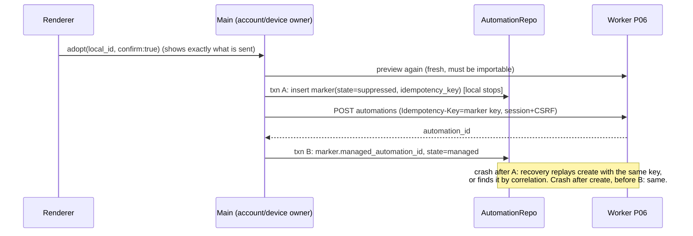

# Lumi automation adoption and managed scheduling

Status: specification for DE2E-INT-05. Nothing here is runtime-proven; each
claim names the evidence still owed. Contracts consumed (verified ancestors of
the paired HEAD): P06-CG `c71a774883dc29ea6117de7c512c3f6c48cd592a` with
P06-CR-001/002/003, P08-CG `8352a7afedc6a450c7dc3eace26a84afb57533c6` with
P08-CR-002. No frozen contract is changed by this spec (see "Wire facts").

## Goal and non-goals

A user with a local scheduled automation can preview what adopting it into a
bound managed workspace would mean, cancel with no effect, or explicitly confirm.
After confirm exactly one scheduler can run each occurrence: the local one (no
adoption) or the P06 managed one (adopted). The local original is never deleted,
edited or uploaded. Non-goals: history sync, prompt/body upload, a second
scheduler authority, server-side runners, adopting automations that have an
unsupported shape (they stay local and visibly "not adoptable").

## Owners (one per fact)

Every Main automation command reads the current human account and requires
active selected-org membership before any operation. Before publishing its
projection it re-reads membership and exact user identity. Renderer org IDs are
selection only. Mid-operation authority loss must remain fail-closed; this
projection guard alone is not proof of atomic mutation/session freshness.

| Fact                                                    | Owner                                     | Never                                                                      |
| ------------------------------------------------------- | ----------------------------------------- | -------------------------------------------------------------------------- |
| Human session, device token, lease token, fence         | Electron Main (`lumiAccountOwner` family) | renderer, host, scheduler process, agent, disk outside the existing vaults |
| Occurrence identity, lease authority, run link, due set | Worker (P06)                              | any client clock or local counter                                          |
| Local original (prompt, cron, workspace, history)       | `AutomationRepo` rows, unchanged          | upload; deletion by adoption                                               |
| Adoption marker (reversible suppression + managed id)   | `AutomationRepo`, one additive table      | credentials, tokens, bodies                                                |
| Which local row a managed occurrence maps to            | the marker                                | the server                                                                 |
| Running the agent turn                                  | host process, existing managed task path  | scheduler process                                                          |
| Preview projection                                      | server `automation-imports/preview`       | the client may not mark a candidate importable                             |

The scheduler utility process keeps owning local due-claiming (`claimDue`,
`claimManualRuns`, off-peak). It never holds a credential and never speaks to the
Worker. It only (a) skips marked automations and (b) asks Main to run one managed
poll. This is the only scheduler path to managed work: no second loop exists.

## Local marker (`automation_managed_adoptions`, migration 0004, additive)

One row per adopted local automation:

`local_automation_id` PK (FK-less; the automation row may be deleted by the
user), `org_id`, `managed_automation_id` (NULL until create is acknowledged),
`state` in `suppressed | managed | releasing`, `idempotency_key`,
`correlation` (opaque `lumi-local:<local_key>`), `created_at`, `updated_at`.

Rules enforced inside the existing `BEGIN IMMEDIATE` claim transactions:

- Expiration and stale-claim housekeeping in due/manual/run-now transactions
  also exclude marked originals. Suppression protects stored local state, not
  merely the final claim selection. A user edit after adoption does not permit
  housekeeping to silently rewrite the retained definition.

- `claimDue`, `claimManualRuns`, `runNow` treat an automation with any marker
  row as not claimable, in every state. Suppression is a filter, not a mutation
  of `enabled`/`lifecycle_status`, so removing the row restores the exact
  original behavior including `next_run_at`.
- Suppression never writes `automations` columns. The original row, prompt and
  `automation_runs` history are byte-identical before preview, after cancel and
  after confirm.
- A marker without a live Main owner stays suppressing. Fail-closed means
  "neither runs", never "both run".

Schema change note: AGENTS.md requires module-maintainer agreement for database
structure. This is an additive table, ledgered like 0002/0003; older builds
ignore unknown ledger rows. Agreement is flagged, not assumed.

## Preview (no mutation anywhere)

```text
Renderer --preview(local_automation_ids, org, workspace)--> Main
Main --read-only--> AutomationRepo (title, schedule kind, workspace; NEVER prompt)
Main --POST adoption/automation-imports/preview--> Worker (human session + CSRF)
Worker --items[{local_key, importable, conflicts[]}]--> Main --> Renderer
```

Candidate = `{local_key, schedule_kind, required_tools[], required_model_capabilities[],
uses_off_peak, credential_mode}` plus the workspace's `adoption_state_ids`. The
client reports what it knows (`required_tools` empty when unknown; the server
says `model_capability_check: deferred_to_dispatch`). Cancel = discard the
projection; there is nothing to undo. Proof: byte hash of the local DB and D1
automation/adoption/audit counts unchanged across preview and cancel. A
non-importable or unsupported schedule is shown with its conflict code and has no
confirm action.

## Explicit confirm and crash-safe order



Invariant: at most one scheduler may execute an occurrence of the original.
Local executes iff no marker row exists. Managed executes iff the marker is
`managed` and the server automation is active. The marker is written before the
server create and removed only after the server automation is confirmed paused
or deleted, so every crash window yields neither or one, never both.

Sent to the server, shown in the confirm dialog: title as `name`, schedule
(cron expression, timezone, kind), target workspace binding, agent definition,
model alias, and `description = lumi-local:<local_key>` as the recovery
correlation. Never sent: prompt, tool arguments, file paths, history, secrets.
The create route requires `Idempotency-Key`; after the P01 idempotency TTL a
replay could create a second managed automation, so recovery first lists the
project automations and matches the correlation before creating.
Recovery validates exact org/project on every row and explicit completeness,
reads at most ten100-row pages, rejects cursor cycles/duplicate IDs and multiple
correlation matches. A partial match or incomplete list cannot authorize create
or adoption. Description correlation remains reconciliation input, not permission.

Preview conflicts retain their stable server code. The Worker uses `subject:null`
for whole-automation conflicts; the desktop normalizes only this explicit null to
an empty display subject. Missing, malformed or oversized subjects still fail
validation. A conflict never becomes importable because its subject is absent.

Return to local ("Release"): Main pauses then deletes the managed automation
(server confirmed), then txn removes the marker. Reverse order is forbidden.
A failed release leaves the marker, so the original stays suppressed and the
user sees a retryable "Release" state.

## Attach to an existing managed automation (DE2E-INT-05, second device)

Adoption above always CREATES a definition. A second desktop of the same user must instead
join the definition another device (or the web console) already owns, otherwise two devices
hold two different definitions and never contend for one occurrence. Attach is that second
path. It reuses the existing vocabulary only: the P06 definition (`aut_…`), the marker table,
the project/binding/device/policy resolution of P06-CR-008. No new server resource, no
implicit conversion, no wire change (no CR): every server call is an existing session `GET`.

```text
Renderer --preview-automation-attach(local id, org)--> Main
Main --read-only--> AutomationRepo (metadata, never the prompt)
Main --authorizeWorkspace--> project/binding of THIS workspace (managed_policy, valid device, fresh policy)
Main --GET /automations?project_id=…--> bounded, validated list (<= 10 pages x 100; shown <= 50)
Renderer --attach-automation(local id, managed id, expectedRevision, expectedVersion, confirm:true)--> Main
Main --GET /automations/{id}--> fresh read-back, re-validated (the list is not authority)
Main --ONE local txn--> marker(state=managed, origin=attached, managed id)
```

- **Consent.** Preview and cancel change nothing. The confirm dialog shows the local original,
  the bounded destination (the project bound to this workspace), and the chosen definition's
  name, schedule and version. It states plainly that nothing is sent and that the original stops
  running here while attached.
- **Validation, from server facts and Main-authorized context only.** The definition must be in
  the workspace's project, `active`, executed as the current user, not off-peak, not pinned to a
  device, and either binding-less or pinned to THIS workspace's own binding. `expectedVersion` must
  equal the fresh read. A refusal is a stable code `automation_attach_*`; refused rows stay visible
  but cannot be selected. The renderer contributes one id; local ids are never proof.
- **Order.** The original is suppressed only after the definition was re-read and validated, in one
  `BEGIN IMMEDIATE` that also checks the original's `revision`, refuses an in-flight local run, and
  lets the existing unique `(org_id, managed_automation_id)` index reject a second local original on
  the same definition. There is no server create, so there is no "marker written, server not" crash
  window; a refused attach writes nothing and the original keeps running locally.
- **Marker origin (migration `0006_automation_managed_attach`, additive column `origin`,
  default `created`).** `created` = this client created the definition; `attached` = shared. Older
  builds' rows read as `created`. Release of an `attached` marker only removes the local suppression:
  it never pauses or deletes the shared definition (other devices keep running it), and it is not
  re-adoptable into a created definition. Release of a `created` marker is unchanged.
- **Execution authority is unchanged.** The marker only suppresses local dispatch and routes a due
  occurrence to a local original. Whether THIS device is offered or may claim the occurrence is the
  Worker's decision (binding resolution, lease, fence, entitlement). Main still requires the run's
  `workspaceBindingId` to equal the binding it authorized, so a marker cannot grant execution.
- **No upload.** Attach sends no request body at all; there is no metadata-only body route involved.
  Managed inference of a claimed run still sends the prompt through the approved gateway as before.
- **Known limits (stated, not hidden).** Device-pinned definitions are refused because the enrolled
  device id is not part of the authorized-workspace context. A definition shared by several devices
  runs on whichever device claims first; an attached device does not learn who won beyond the stable
  `occurrence_already_claimed`.
- **Instructions stay on this device (decided).** The privacy contract keeps prompts local: the
  Worker definition carries no prompt and attach never uploads, hashes or compares one. Main reads
  the retained original's prompt at dispatch (see "Managed scheduling"). Attach is therefore NOT
  "a shared prompt": it points the existing managed schedule (`aut_…`) at THIS device's original,
  which is what runs whenever this device claims an occurrence. Two attached devices with
  different originals run different work under one schedule; keeping them equivalent is the
  user's responsibility. Consequently:
  - the confirm dialog describes the action as "this device's original will execute that existing
    scheduled automation" and never claims a server-held or shared prompt;
  - confirm requires an explicit, unchecked-by-default acknowledgement that the instructions of
    this device's original are what run here and may differ from other devices;
  - the command carries `acknowledgeLocalInstructions: true` (a boolean, no content). Main
    validates it exactly like `confirm`; the owner refuses with the stable
    `automation_adoption_confirm_required` when it is absent or not `true`, before any read or
    write. A replay of an already-recorded identical attach stays idempotent.
  A server-held prompt reference remains a possible future product change and would need its own
  spec/CR; nothing here assumes it.

Proof owed (none claimed): attach through the real Electron UI with two enrolled devices; the race
stage must replace `seedLocalAutomations … markManaged` for client B with this path and keep its
server-binding assertions; a cross-tenant negative (definition of another org/project is refused
before any marker); fault the validation (principal, project, binding) and the single-transaction
order in a disposable worktree and show each verifier fails for that reason.

## Managed scheduling (due to settled)

```mermaid
sequenceDiagram
 participant S as Scheduler process
 participant M as Main
 participant W as Worker
 participant H as Host
 S->>S: tick: any marker with state=managed? none => nothing
 S->>M: managed-poll-request {} (no ids, no token)
 M->>M: single-flight; Host available? else skip (no claim)
 M->>W: GET /devices/automations/due (device token)
 M->>M: skip items without a managed marker; refuse off_peak (shared P06 classifier)
 M->>W: claim -> lease token, fence (guard.acceptClaim)
 M->>M: journal(occurrence, starting)
 M->>W: start -> run_id, session  (guard.acceptStart)
 M->>M: journal(occurrence, started, run_id)
 M->>W: P05 GET run (queued) validated against grant + marker + workspace
 M->>W: P05 start -> running + request_id (context from server facts)
 M->>M: register lease in managedRuns (request auth now possible)
 M->>H: lumi-managed-automation-run {context, prompt read locally by Main}
 H->>H: prepare alias, createTask, sendPrompt(modelExecution.managedContext)
 loop heartbeat_interval_seconds
  M->>W: renew (failure => lease lost, stop, ambiguous)
 end
 H->>M: terminal outcome (existing managed terminal relay)
 M->>W: P05 complete|fail|cancel, then P06 settle(outcome); journal settled
 M->>W: (pre-start refusal only) release
```

The scheduler is a trigger only. It writes no `automation_runs` row and calls no
`markDispatched`/`markRunDispatch` for a managed occurrence, because those rewrite
`run_count`, `next_run_at` and history of the retained original. The prompt is
read by Main from the original at dispatch time and travels only Main→Host over the
existing private parentPort; it never reaches the scheduler process or the Worker.
Managed inference still sends the prompt content through the approved gateway:
"stays on the device" is NOT claimed, only "not uploaded in adoption metadata".

Rules:

- `P06AutomationFenceGuard` / `P06AutomationOccurrenceRunner` are the only
  decision points for fence, grant and ambiguity. No renewal, settle or tool
  result is accepted without a current fence.
- No side effect before the start grant. A `claimed` occurrence whose start
  fails is released only if the guard is still pre-start.
  A lost start response,5xx,unknown refusal or invalid grant is ambiguous delivery,
  even if the local guard never received acceptStart. Do not release or requeue;
  return needs-reconciliation. Only explicit known pre-start eligibility refusals
  permit best-effort release; server fence remains authoritative. That list lives
  only in `isStartRefusedBeforeStart` (`automationOccurrenceDriver.ts`) and is the
  Worker's pre-write refusals: `require_device` (`device_token_expired`),
  `authorize_device` (`device_revoked`, `device_not_approved`,
  `organization_not_active`), the frozen `device_not_eligible`, and `dispatch_block`
  as re-read by `start` (`organization_suspended`, `organization_not_found`,
  `organization_pending_deletion`, `execution_principal_unavailable`,
  `policy_snapshot_stale`, `entitlement_not_granted`, `entitlement_grace_expired`,
  `entitlement_limit_exceeded`). Only a 4xx with one of these reasons counts.
- Restart: an in-memory lease cannot be re-adopted (the raw token exists once).
  After restart, an occurrence that had started is not retried: Main reports it
  to the user as needs-reconciliation and never re-dispatches
  (`classifyInterruptedAutomationOccurrence`). A claimed-but-unstarted lease
  expires server-side and is re-claimable only if the server proves not started.
- Revoked device, lost entitlement, off-peak refusal, stale policy, stale or
  unknown fence and ambiguous state all end the attempt locally with the stable
  code from the contract; none retries.
- Unknown/unsupported binding or an automation with no marker is never claimed:
  it is left to its owner (other clients/web), no release/claim churn.
- Two clients: the Worker's single active lease decides. The loser gets
  `occurrence_already_claimed`, learns nothing else and executes nothing.

## Downgrade compatibility guard (migration 0005)

"Older builds ignore the marker" is NOT a safety property: an older build opens the
same tasks-index, never reads `automation_managed_adoptions`, and would claim and run
the retained original while the managed copy is also active. Coordinator reproducer
`automation-downgrade-query-reproducer.log` shows the trusted-baseline selection
still returns an adopted original. The guard must therefore live in the database,
not in new client code.

Migration `0005_automation_managed_guard` (additive, new ledger id; 0004 is not
edited) creates a `BEFORE UPDATE OF running` trigger on `automations` that applies
`RAISE(IGNORE)` when a row goes `running` 0→1 while a marker row exists for it. Every
claim path of every build is a conditional `UPDATE ... SET running = 1 ... WHERE
running = 0` followed by a `changes === 1` check (`claimDue`, `claimManualRuns`,
`runNow`), so the update becomes a silent no-op and the old build treats the row as
"not claimed". No column of the original is written; removing the marker restores the
original behavior byte-for-byte. The trigger stays installed after release (it is
inert without a marker).

Limits stated plainly: it does not stop an old build's expiry/stale-claim housekeeping
from rewriting `lifecycle_status`/`running` of an `end_at`-expired original (those
statements do not change `running` 0→1), it is not an auth boundary against a
hostile local writer, and it is not evidence about any old binary: proof is a real
SQLite database exercised with the pre-guard `claimDue`/`claimManualRuns`/`runNow`
statements copied from the trusted baseline. A build that lacks even this trigger
(older than 0005 and never opened by a 0005 build) cannot be protected; the user is
told in the confirm dialog that older Lumi/ZCode builds sharing this data folder must
be updated before adoption. 0005 is applied by the same migration runner before any
adoption can be written, so a DB that contains a marker always contains the trigger.

## Managed occurrence journal (migration 0005)

Table `automation_managed_occurrences` (additive): `occurrence_id` PK, `org_id`,
`local_automation_id`, `managed_automation_id`, `run_id` NULL, `state` in
`starting | started | settled | ambiguous | released`, `reason` NULL (closed stable
code), `created_at`, `updated_at`. No token, prompt, path or lease material.
`released` is a confirmed pre-start `release` and is only reachable from `starting`.

- Written by Main only, through a decorator around the lease port
  (`createJournaledLeasePort`, so the driver and guard are unchanged): `starting`
  immediately BEFORE the `start` request (if it cannot be written, `start` is never
  sent), `started` with the server `run_id` after the grant, `settled` after a
  successful P06 settle, `ambiguous` for lost-start delivery (any `starting` row not
  confirmed started or released when a poll ends), lease loss and unconfirmed settle.
  States only move forward; `settled`/`ambiguous` are terminal.
- A raw lease token exists only in process memory, so after a restart any row still
  `starting`/`started` cannot be continued. Main marks every such row `ambiguous`
  (`process_restarted`) at startup, surfaces "Needs reconciliation" and NEVER
  re-dispatches. The server independently turns a started occurrence with an expired
  lease into `ambiguous`; a never-started `leased` occurrence becomes re-claimable by
  the server's own rule, which the client does not second-guess.

## Mutation freshness

- Local metadata revision: preview rows carry `revision` (the original's
  `updated_at`). Definition edits, pause/resume and restart advance this value
  monotonically, including edits within one millisecond or a backward wall clock.
  `adopt` carries `expectedRevision`; `beginManagedAdoption` compares
  it with the stored row INSIDE its `BEGIN IMMEDIATE` and refuses
  (`automation_adoption_changed`) on mismatch, before the marker is written and
  before any server create. The create body is built from the same read.
- Account generation: Main keeps a counter bumped on sign-out and sign-in
  completion. Every automation command captures it, checks it before EACH server call
  and local mutation, and again before publishing. A change yields
  `lumi_account_changed`; a marker already written stays suppressed (neither runs).
  The same-user check stays as a second condition.
- Recovery correlation (`lumi-local:<id>`) is unique within one data folder only.
  Recovery still validates org/project/exact-row/uniqueness; scoping it to the
  enrolled device ID is OWED (not claimed) and noted as a limitation.

## Managed run activation (Main)

After `start` the P05 run is `queued`. Main performs, in order and each fail-closed:

1. read the P05 run with the device token and require exact equality with the grant
   (`run_id`, `agent_session_id`), org, device and the marker's managed automation;
2. require the run's binding to equal the currently authorized binding of the
   original's local workspace (`authorizeManagedWorkspace`), and that the run's
   policy snapshot/version equal the occurrence's (stale policy refuses, never
   re-resolves to the newer one);
3. P05 start (`queued → running`, returns `request_id`);
4. build the `ZCodeManagedRunContext` only from server-issued values and register
   the lease in `managedRuns` exactly like an interactive run.

Any failure after the P06 `start` grant is a post-start failure: P05 fail/cancel
(best effort), P06 `settle(failed, reason)`, journal accordingly. It is never a
`release` and never a retry. The renderer, scheduler process and Host never see the
lease token, fence or device token; the Host receives only the context.

## Off-peak and ineligible work

An occurrence whose `off_peak_mode` is `off_peak` is never claimed here: the Host path
does not yet enforce the narrowed tool constraints
(`narrowOffPeakToolConstraints`), and claiming without them would broaden a host
restriction. The decision has one owner, the shared P06 classifier
`resolveAutomationExecutionClass`, called by the occurrence driver before the claim
with no enforceable off-peak policy; the poll reports the frozen reason
`off_peak_not_allowed` and nothing is claimed or journaled. Adoption never sets an `off_peak_policy`, so this is a fail-closed
refusal, not a feature gap for adopted crons. Local off-peak tasks
(`OffPeakTaskRepo`) are untouched.

## Lease loss and cancellation

Each active occurrence has one renewal timer at the server's
`heartbeat_interval_seconds`. A renewal refusal (stale fence, expiry, revoked device,
entitlement loss, ambiguity) ends authority: the lease is removed from `managedRuns`
so the next inference/tool request fails closed, P05 cancel is attempted best effort,
the journal row becomes `ambiguous`, and nothing is retried or settled over a newer
server state. User cancellation of the task follows the existing terminal relay
(`stopped` → P05 cancel → P06 `settle(failed, user_cancelled)`).

### Lease loss stops the owning Host's work

Removing the lease only makes the _next_ request fail closed; an in-flight model stream
or tool call keeps running. Ending authority therefore also stops the work, through one
path and one owner per fact:

```text
Main runtime leaseLost
  1. ended=true, heartbeat stopped            (no later settle / retry / dispatch)
  2. activation.revoke(runId)
       a. unregister lease                    (authority gone first)
       b. HostBridge.cancel(runId) ──┐        run → owning Host (recorded at dispatch)
       c. P05 cancel (best effort)   │ concurrent
  3. journal ambiguous(lease_lost)   │
                                     ▼
Host managedAutomationRunner.cancel(runId)    run → { services, taskId, phase }
  - sets run.cancelled (checked synchronously before every next step)
  - taskId known → IZCodeTaskService.stopGeneration (v4 `stop` → turn abort signal)
  - ACK { requestId, runId, ok, outcome | errorCode }
```

Owners: Main's bridge owns `runId → Host` (it chose the Host and posted the dispatch);
the Host runner owns `runId → services/task` and the cancelled flag. Nothing else
keeps either mapping, and there is no renderer command or global "stop everything".

Cancellation phases (the cancelled flag is checked after every `await` and
synchronously before each side-effecting call, so a cancelled run never starts the
next step):

| Phase when cancel arrives           | Effect                                                                                                                                                                                                        | ACK outcome                |
| ----------------------------------- | ------------------------------------------------------------------------------------------------------------------------------------------------------------------------------------------------------------- | -------------------------- |
| before Main dispatches              | cannot happen: the heartbeat starts after activation and `dispatch` is called with no `await` in between, so a renewal refusal can only land after the run message is posted (and the owner Host is recorded) | n/a                        |
| run message posted, not yet handled | one port is ordered, and the runner records the run in its synchronous prefix, so the run is always known before its cancel is handled                                                                        | as the phase it then finds |
| alias registration pending          | no task is created                                                                                                                                                                                            | `prevented`                |
| `createTask` pending                | task exists (deferred persistence), no prompt is sent                                                                                                                                                         | `prevented`                |
| `sendPrompt` pending                | stop is issued now **and again after the prompt is admitted** (a stop that races ahead of admission is a no-op)                                                                                               | `stopped`                  |
| prompt dispatched / running         | `stopGeneration(taskId)` for that one task only; other tasks and the Host are untouched                                                                                                                       | `stopped`                  |

Invariants:

- Unknown run id (never dispatched to that Host, or retired) → `ok:false`
  `lumi_managed_automation_run_unknown`; Main never guesses another Host or task.
- Stop authority (`runId → Host`) is never evicted while the run may still be active.
  A run counts as active from dispatch until the bridge has proof it is over: the Host
  confirmed a stop for it (`stopped`/`prevented`/`already_cancelled`), a post to the
  Host threw (the run message never left Main), or the runtime retired it with
  `retire(runId)` after a proven terminal (the activation `settle`/`revoke` path).
  An accepted dispatch alone is NOT terminal, and neither is a timeout or a Host
  refusal (the Host may still hold a task). The active set is bounded
  (`MAX_ACTIVE_RUNS` = 256): at the bound `available()` is `false` (so the poll does
  not claim) and `dispatch` refuses with `lumi_managed_automation_host_busy` without
  posting or evicting anything. Stop-confirmed entries are kept only to answer
  duplicate cancels `already_cancelled` and are bounded separately (oldest first).
  A run id that is already remembered (active or confirmed) is refused with
  `lumi_managed_automation_run_duplicate`; it never replaces the recorded Host.
  The capacity bound documents when Main stops admitting new work; it never
  authorizes dropping an existing run's stop authority.
- Retirement wiring (the only ways an active owner is freed):
  1. `activation.settle(runId, …)` is the Host's terminal relay (`succeeded` / `failed` /
     `stopped` from the task). Once it has found the lease and ended authority it retires
     the run exactly once, whatever the P05 report/P06 result is afterwards:
     the Host task is proven over, a failed P05 report only affects the server record.
  2. `revoke(runId)` does not retire; a Host-confirmed stop frees the slot inside the
     bridge. An unconfirmed (refused, timed-out, unknown-to-Host) stop keeps the owner.
  3. A dispatch that failed after the run message was posted (`activation.failDispatch`:
     Host refusal or timeout) is NOT a terminal proof. It settles the occurrence as
     before, then asks the owning Host to stop that one run; only the Host's confirmed
     ACK frees the slot.
  A late or unknown terminal (lease already removed) is refused with
  `lumi_managed_run_missing` and retires nothing; a later retried stop can still free it.
  Limitation: a run whose stop stayed unconfirmed and whose Host terminal then arrives
  after the lease was removed keeps its slot until the process restarts. This is the
  fail-closed side of the bound; there is no global Host stop.
- Duplicate cancel is idempotent: concurrent calls share one stop; a confirmed run
  answers `already_cancelled` without a second stop. A failed stop (`…_stop_failed`)
  is not memoised, so a retry really retries.
- Cancel and its ACK are strict (`.strict()` schemas): a run id, a request id, stable
  codes. No token, fence, lease, device credential or prompt has a field.
- A stopped task's terminal relay (`stopped`/`failed`) reaches Main after the lease was
  removed, so `settleManagedRun` refuses it (`lumi_managed_run_missing`): the runtime
  never reports success or schedules a retry for a run it lost.
- Unit tests prove the ordering and the Host race handling; that a real Agent turn
  actually aborts is a runtime claim and stays UNPROVEN until the Electron proof.

Not covered here: sign-out and shutdown still end authority without stopping the Host
task (the lease is gone, so requests fail closed); they should reuse `revoke`'s Host
stop and are tracked as a remaining gap.

## Wire facts (verified from source, runtime still UNPROVEN)

The client strict schemas in `packages/shared/src/p06-automation-lease.ts` do not
match the Worker handlers' actual JSON (`apps/api/src/routes/automations.rs`):

| Route              | Worker returns                                                                                          | Client schema expects                                               |
| ------------------ | ------------------------------------------------------------------------------------------------------- | ------------------------------------------------------------------- |
| `GET due`          | `{items[], next_cursor, has_more}`; item has `scheduled_for_utc`, `state`, no `execution_principal`     | `{items[]}` strict; item has `scheduled_for`, `execution_principal` |
| `claim`            | flat `{occurrence_id, attempt, lease_id, lease_version, lease_fence, expires_at, state, lease_token}`   | `{occurrence{}, attempt, device_id, lease{}, lease_token}`          |
| `start`            | grant plus `expires_at`                                                                                 | grant strict, no `expires_at`                                       |
| `renew`            | flat `{lease_id, occurrence_id, lease_version (+1), lease_fence (unchanged), expires_at}`, no `attempt` | `{occurrence_id, attempt, lease{}}`                                 |
| `settle` request   | no `run_id` (`deny_unknown_fields`)                                                                     | `run_id` required                                                   |
| `settle` response  | `{occurrence_id, state, run_id, lease_id}`                                                              | `{settled_state, lease_version, lease_fence, idempotent}`           |
| `release` response | `{occurrence_id, lease_id, state}`                                                                      | `{released:true, lease_version, lease_fence}`                       |

Decision: the client adapts to the deployed projections inside one services
transport; the wire stays unchanged, so no CR. Missing facts the transport must
obtain from authoritative sources instead of inventing: the execution principal
comes from the server's session `GET automations/{id}` for the marker's own
automation, the device id from the Main device credential, the claimed-lease
`occurrence` ref from the due item the claim answered. If a required fact is
absent the transport refuses (`automation_wire_invalid`); it never fabricates a
`user` principal. The shared strict schemas stay as the guard's internal type and
are not loosened. A runtime probe against the real Worker is the evidence for each
mapping; unit tests with source-derived shapes are only the regression net.

### Due policy is server-resolved and mandatory (control-plane P06-CR-007)

The `due` item's `policy_snapshot_id` and `policy_version` are the policy the server
bound when it dispatched the occurrence; they are the same values the claim's
occurrence ref, the P05 run and Main's activation guard compare. A first runtime replay
showed a Worker that dispatched with both `null`: the client refused the list with
`automation_wire_invalid` every poll and never claimed. That refusal was correct and
stays:

- A due item with an absent or `null` policy, a non-`pol_` snapshot id or a non-positive
  version is `automation_wire_invalid`. It is never claimed, never defaulted from the
  device's own policy snapshot, and no lease is requested.
- The check happens on the due item, BEFORE `claim`, with the same rules the claim decode
  applies afterwards. Otherwise a malformed-but-string value would be granted a lease by
  the Worker and only then rejected, spending a server attempt and leaking the lease.
- `start` carries no policy; the run's policy is whatever the claimed occurrence carried,
  and Main's activation guard still refuses a run whose policy is missing or differs.

The repair for the observed `null` is on the Worker (it binds the latest published
snapshot at dispatch). No client schema is loosened.

## States shown to the user

Not adoptable (conflict code), Previewed, Awaiting confirm, Suppressed
(finishing), Managed, Releasing, Needs reconciliation (ambiguous or interrupted
started occurrence), Control plane unavailable (local keeps running unless
marked). Every state has keyboard-reachable actions, a visible focus ring and an
error/empty/loading projection per DESIGN.md.

## Proof obligations (all owed; none claimed)

1. Preview and cancel leave local DB hash, D1 rows and audit unchanged.
2. Confirm preserves the original row/history; suppression works across a Main
   crash at each of the three windows (after A, after create, after B).
3. A real due managed occurrence claims, starts, runs a managed agent turn and
   settles; D1 shows occurrence, link, run, usage, audit for the same ids.
4. Two real clients race one occurrence; exactly one runs; loser disclosure is
   limited to `occurrence_already_claimed`.
5. Restart mid-run, lease expiry, stale fence, device revocation, entitlement
   loss, off-peak refusal and ambiguous outcome match P06-CG; no replay.
6. Unrelated local automations, other workspaces, BYOK and custom MCP unchanged;
   unavailable control plane and version mismatch leave local scheduling intact.
7. Fault the load-bearing invariants (marker filter, fence guard, release-order,
   principal check) in a disposable worktree and show each verifier fails for
   that reason after its positive control.

## Resume checkpoint (child implementation, 2026-10-08)

Verified baseline: P06 `c71a774` and P08 `8352a7a` are ancestors of the paired
HEAD. Toolchain drift: this work ran on local Node 22.14, not the pinned 24.14.

Implemented (client working tree, uncommitted) and unit-proven only:

- migration `0004_automation_managed_adoption` + marker store; `AutomationRepo`
  suppresses `claimDue`, `claimManualRuns`, `runNow` for any marked original.
- session transport: preview, create, correlation lookup, pause/delete with readback.
- device lease transport (`automationLeaseTransport.ts`): the only mapping from
  the deployed Worker projections to the guard's types; refusals keep the stable
  server reason and never the lease token.
- pure adoption owner (preview, adopt, recover, release) and managed occurrence
  driver (claim/start/renew/settle/release over `P06AutomationFenceGuard`).
- Main assembly (`lumiAutomationOwner.ts`), command validation
  (`lumiAutomationCommands.ts`), additive shared command/projection types and
  four IPC actions (`preview-automation-adoption`, `adopt-automation`,
  `release-automation`, `read-automation-adoptions`). Unit-proven with a real
  `AutomationRepo`: the prompt never reaches the server fake; a bot-delivery
  original, including a malformed stored target, is not adoptable
  (`hasBotDeliveryTargetRaw` fails closed instead of trusting the parsed value).
- Seams touched outside this packet's files, all additive: shared
  `lumi-account.ts` union, `lumiWorkspaceAuthorization` (returns
  `adoptionStateId`), one spread in `lumiAccountOwner`, one call in
  `lumiAccountCommands`.
- Evidence: 80 tests across desktop `lumi*`, services `lumi-account` and the
  marker store (121 including the shared P06 guard tests), `tsc` for
  shared/services with no errors in changed desktop files, oxlint 0 errors, oxfmt,
  `architecture:check --changed`, `lumi:notice`. Fault checks: removing the
  claim filter, inverting the release order and claiming unadopted occurrences
  were each detected for the intended reason and restored.
- Pre-existing, not mine: `tsc -b` for `packages/desktop/tsconfig.main.json`
  reports about 90 errors in untouched files (for example `appARMSBootstrap.ts`,
  `browserGuestManager.ts`).

Owed, in dependency order (none claimed): (1) Main managed-run registration for
an occurrence (P05 queued to running, `ManagedRunContext`, lease registered so
request auth works, results routed to Main and never to the scheduler's local
settlement, which would rewrite the original's `run_count` and `next_run_at`);
(2) renderer preview/confirm/release UI per DESIGN.md; (3) scheduler
tick posts a managed poll to Main, Main registers the P05 run (queued to running)
and dispatches to the host with the managed context and the prompt read locally;
(4) terminal settlement order P05 complete/fail then P06 settle; (5) Worker and
Electron two-client probes for restart, expiry, stale fence, revocation,
entitlement loss, off-peak and ambiguity; (6) module-maintainer agreement for the
schema addition; (7) runtime proof for every mapping in the wire-facts table.
